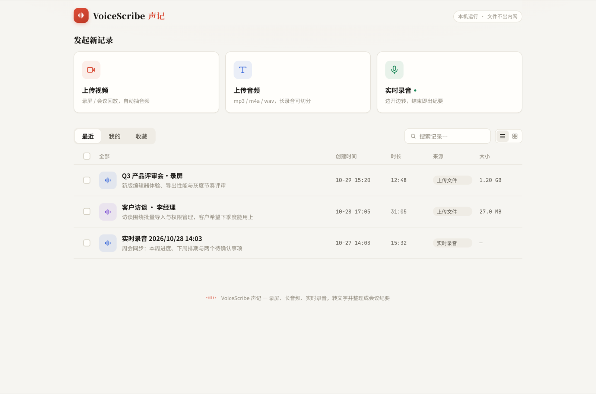
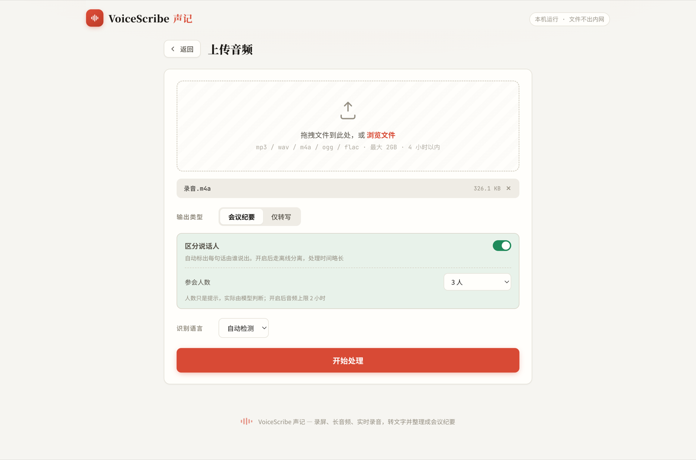
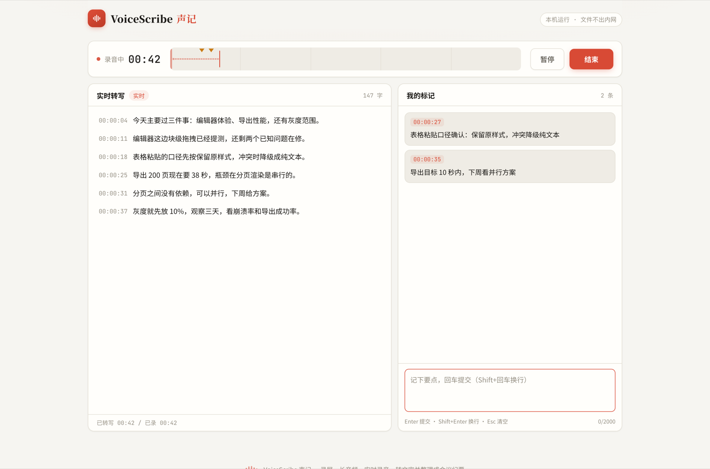
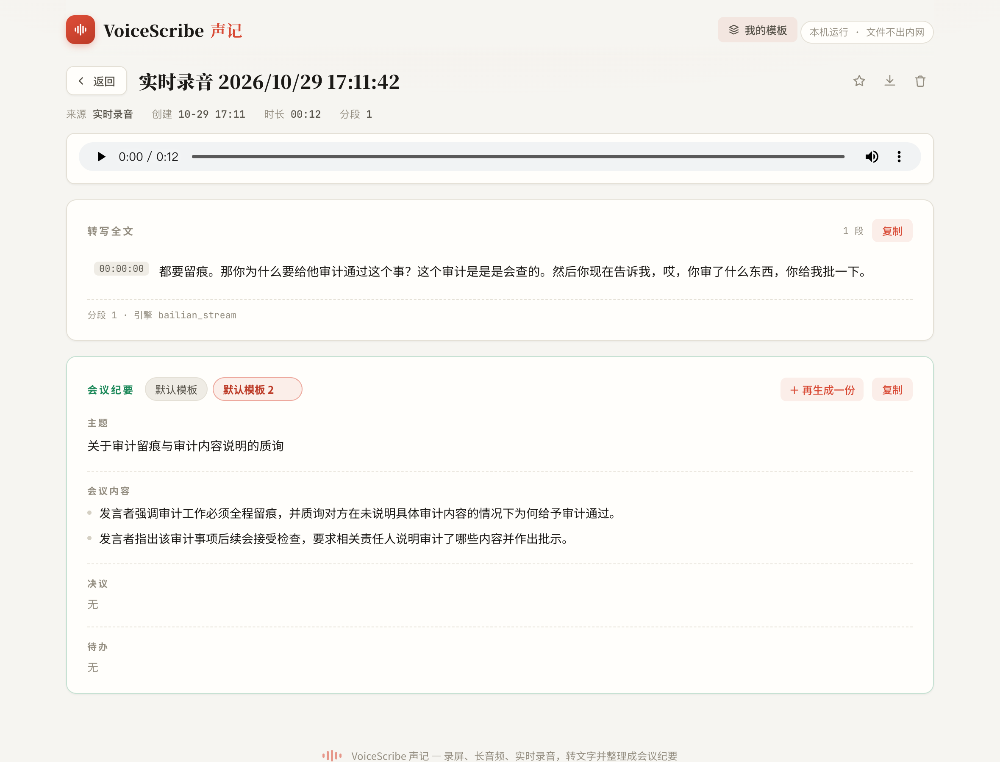
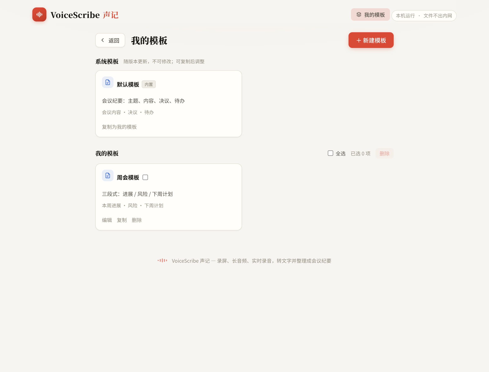
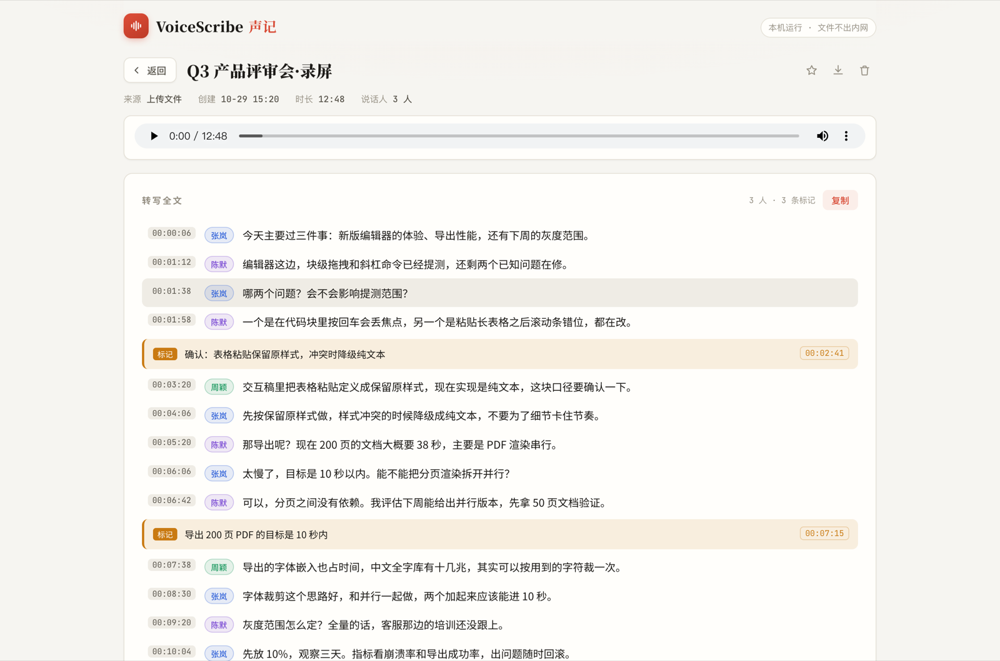

# VoiceScribe 声记

**录屏、长音频、实时录音 → 文字 → 结构化会议纪要**，一个在自己电脑上跑的会议纪要工作台。

线上会议只拿到录屏？把文件丢进来，它会自动抽音频、切片转写、整理成带时间戳的会议纪要；开会时也可以直接开麦克风实时转字幕，边听边记要点，结束后一键出纪要。

- 应用与数据都在本机：只监听 `127.0.0.1`，单用户；模型密钥只留在服务端，不下发浏览器
- 三条转写通道：MIMO 切片（默认）、百炼流式（兜底 / 实时录音）、百炼离线分离（说话人）
- 录音页是三区工作台：顶部时间轴、左侧实时转写、右侧用户标记（回车成条，时间自动对齐）
- 结果落 SQLite，支持搜索、收藏、详情回放、说话人改名、重新标注、批量删除
- 纪要模板可自定义：系统模板 + 自建模板，同一份转写可出多份纪要，切换不重新调用模型



> 下文截图为演示数据，不含真实会议内容。

> 「区分说话人」本期只作用于**静态文件**。实时流式模型不返回说话人，录音页的开关保留但锁定，点击会说明原因。

---

## 功能特性

### 三个入口

| 入口 | 适用场景 | 处理方式 |
| --- | --- | --- |
| **上传视频** | 会议录屏、回放（mp4 / mov / mkv / avi / webm…） | 自动抽音轨 → 转写 → 纪要 |
| **上传音频** | mp3 / m4a / wav / ogg / flac 等录音文件 | 静音对齐切片 → 转写 → 纪要 |
| **实时录音** | 现场会议、访谈、语音备忘 | 浏览器采音 → 服务端代理百炼流式识别 → 实时字幕 → 结束生成纪要 |

### 长音频处理

- 按 **30 秒**切片（实测 MIMO 在 45s 开始截断、90s 几乎失效），切片点对齐静音段，避免切在字中间
- 并发 4 片转写；任务之间串行排队，避免多个 ffmpeg 抢 CPU
- **字率护栏**：某片字数低于 1.2 字/秒，或 10 秒以上的片段不足 12 字，判为模型退化，自动改用百炼流式兜底
- 断点续跑：切点由音频内容决定、可复现，服务重启后点「继续处理」只补未完成的片
- 支持取消，状态与进度实时回传：读取文件信息 → 抽音频 → 规划分段 → 转写 → 纪要

### 区分说话人（静态文件）

上传页打开「区分说话人」后，整文件改走百炼离线分离通道，每句话都会带上说话人标签。



- 关 → MIMO 切片转写；开 → 百炼 `qwen-audio-3.0-asr-flash-filetrans` 整文件异步识别
- 离线通道四步：取上传凭证 → 直传 `oss://` → 提交异步任务 → 轮询取结果；一次任务内说话人编号全局稳定
- 可选「参会人数」提示（自动 / 2~6+），用于收敛自动聚类偏多的情况
- 结果异常显式暴露：只有一个编号 → 判「分离未生效」，文本照用但给出横幅；编号过多 → 判「疑似过度聚类」，可重新标注
- 详情页可给说话人改名（如「说话人2」→「张总」），改名会同步到每一段；纪要里的负责人要**重新生成纪要**才会用上新名字
- 上线前先验证模型：`npm run verify:diar -- testData/双人对话.m4a --speakers 2`（换成你自己的双人对话音频）

> 开启分离后音频上限 **2 小时**，超过时上传页的开关会置灰并说明原因；关闭开关仍可处理到 4 小时。
>
> 开启分离时，抽出的 16k wav 会临时上传到百炼提供的 OSS 空间（凭证有效期约 48 小时，仅用于本次任务）；关闭开关时音频只在本机流转，不会外传。

### 实时录音工作台



- 三区布局：顶部时间轴（波形 / 播放头 / 标记钉）、左侧实时转写、右侧用户标记；窄屏下自动切成「实时转写 / 我的标记」两个 tab
- 标记：首次键入（含输入法开始选词、粘贴）就锁定音频时间戳并显示「开始于 00:12:43」，回车成条；中文输入法选词回车不会误提交
- 标记与字幕共用同一条音频时钟：暂停时时间轴冻结，暂停期间记的标记标为「暂停中」，落在暂停点
- 录音音频边录边落盘（16k 单声道 WAV），详情页可直接回放、点时间戳跳转
- 纪要生成时标记作为高优先级上下文注入，并单独输出「现场标记」一节，逐条标注是否被采纳
- 结束录音时若还有未提交的草稿，会自动提交，不会丢最后一条

### 会议纪要



- **转写与纪要是两个动作**：任务只负责转写；纪要由独立接口生成，可反复重跑
- map-reduce 两段式：每 ~1800 字先出分片摘要，再合成结构化结果（长会议不会只总结开头）；单块短会议直接一次生成，省掉一次往返
- 章节由模板决定：默认模板输出 主题 / 会议内容 / 决议 / 待办 / 参会人 / 现场标记 / 按人要点；自定义模板可换成任意章节
- **一份转写可以有多份纪要**：每次生成都是新增，界面上以并列胶囊切换，**不会覆盖已生成的版本**
- 转写与标记合成同一条时间轴事件流，prompt 会写明「标记必须逐条处理」；模型漏掉的标记会按原文补回，标为「未纳入」而不是静默丢弃
- 同时生成 Markdown，可一键复制或导出；导出文件名带模板名与生成时间，不同版本不会互相覆盖
- 纪要失败只影响纪要本身，转写结果与任务状态不受影响，可原地重试

### 纪要模板



- **系统模板**：随版本更新，不可修改、不可删除，可「复制为我的模板」后调整
- **我的模板**：新建 / 编辑 / 复制 / 删除，支持单选与全选后批量删除；名称在自定义模板之间唯一
- 模板由 1~8 个「章节」组成，每个章节有标题、类型（列表 / 段落 / 待办）与写作提示；顺序即纪要顺序
- 生成时从浮窗选模板；不选则用系统默认模板。上传页可预设模板并勾选「转写完成后自动生成纪要」
- 生成时会对模板做快照：之后改名、改章节、删除模板，都不影响已经生成的纪要（卡片上会标注「模板已删除」）

### 记录工作台



- 最近 / 我的 / 收藏三个 tab，关键词搜索（按标题），列表与网格两种视图，视图偏好记在本地
- 分页加载（加载更多）
- 行首复选框 + 表头全选，选中后底部浮出批量操作条，可一次删除多条记录（连带清理任务目录与数据库关联行）
- 详情页：分段时间轴转写、标记行、音频播放器（点时间戳跳转）、说话人 chip 就地改名、收藏、导出 Markdown、删除、重新生成纪要
- 旧记录（无分段数据）自动降级为纯文本展示，可复制；重出纪要同样走 `/api/minutes`（内部按行构造伪分段）

---

## 环境要求

| 依赖 | 版本 / 说明 |
| --- | --- |
| Node.js | **≥ 22.13**（依赖内置 `node:sqlite`，无需安装数据库；本项目在 v22.22 实测） |
| ffmpeg | 需在 PATH 中，用于探测、抽音频、切片（本项目在 9.0.1 实测） |
| 网络 | 能访问 MIMO 接口、阿里云百炼 WebSocket 与 OSS（开启分离时） |
| 磁盘 | 录音/转写音频约 **115MB/小时**，任务目录随记录删除一起清理 |

---

## 快速开始

### 1. 安装依赖

```bash
npm install
```

### 2. 配置环境变量

```bash
cp .env.example .env
```

然后填入自己的凭证：

| 变量 | 必填 | 用途 | 示例 / 默认值 |
| --- | --- | --- | --- |
| `MIMO_API_KEY` | 是 | MIMO 接口密钥（转写 + 纪要共用） | `sk-...` |
| `MIMO_API_URL` | 是 | MIMO Chat Completions 地址 | `https://api.xiaomimimo.com/v1/chat/completions` |
| `MIMO_ASR_MODEL` | 是 | 静态文件转写模型 | `mimo-v2.5-asr` |
| `MIMO_SUMMARY_MODEL` | 是 | 纪要生成模型 | `mimo-v2.6-flash` |
| `DASHSCOPE_API_KEY` | 实时录音 / 分离时必填 | 百炼密钥 | `sk-...` |
| `BAILIAN_WS_HOST` | 实时录音 / 分离时必填 | 百炼 workspace 专属域名 | `{WorkspaceId}.cn-beijing.maas.aliyuncs.com` |
| `BAILIAN_WORKSPACE` | 实时录音时必填 | 百炼 workspace id | `{WorkspaceId}` |
| `ASR_MODEL` | 否 | 百炼流式识别模型 | `qwen-audio-3.0-asr-flash-streaming` |
| `DIAR_MODEL` | 否 | 静态文件的说话人分离模型 | `qwen-audio-3.0-asr-flash-filetrans` |
| `PORT` | 否 | 服务端口 | `3000` |

> 百炼的三项参数都来自控制台下载的 `apiKey-*.csv`（`apiKey` / `apiHost` / `workspaceId`）。
> 缺少 MIMO 配置时启动会告警「转写与纪要会失败」；缺少百炼配置时告警「实时录音不可用」，静态文件转写不受影响。
> `ASR_MODEL` / `DIAR_MODEL` 不填就用上表默认值。

#### 也可以在界面里改（不必改文件）

顶栏「模型配置」可以逐项改这四类模型服务：

| 配置项 | 对应 .env | 作用 |
| --- | --- | --- |
| 纪要生成 | `MIMO_API_URL` / `MIMO_API_KEY` / `MIMO_SUMMARY_MODEL` | 会议纪要（map-reduce 摘要） |
| 非实时 · 说话人不分离 | `MIMO_API_URL` / `MIMO_API_KEY` / `MIMO_ASR_MODEL` | 静态文件转写 |
| 非实时 · 说话人分离 | `BAILIAN_WS_HOST` / `DASHSCOPE_API_KEY` / `DIAR_MODEL` | 离线分离（filetrans） |
| 实时 | `BAILIAN_WS_HOST` / `DASHSCOPE_API_KEY` / `ASR_MODEL` | 实时录音（流式 WebSocket） |

规则是**逐字段合并**：

- 界面里显示的地址与模型 ID 默认就是 `.env` 里的当前值（`.env` 改了，界面跟着变）；
- 密钥框**留空 = 沿用服务端 `.env` 的密钥**，服务端密钥不会下发到浏览器；
- 只有在界面里改动过的字段才会存进浏览器的 localStorage，随请求带给后端；
- 后端解析时同样是「浏览器填了的用浏览器的，没填的回落 `.env`」。

配置只存在浏览器本地（`localStorage`），不会上传到任何服务器；但**音频是否出本机取决于你填的服务地址**——指向云端模型时，音频会被转发给那个服务商。

弹窗里的「测试连接」是**真检测**，会按各引擎真实发一次最小请求：

| 配置项 | 探测方式 |
| --- | --- |
| 纪要生成 | 发一条极短的对话（chat completions） |
| 非实时 · 说话人不分离 | 发 0.25 秒静音音频（识别模型只认 `input_audio`，纯文本会被拒） |
| 非实时 · 说话人分离 | 取一次 OSS 上传凭证（GET，带模型参数） |
| 实时 | 连一次 WebSocket 并发起一个空任务，模型没开通会被当场拒掉 |

所以它能同时验出地址、密钥、模型三件事；密钥错会直接看到服务返回的 `401 Invalid API Key`。

### 3. 启动

```bash
npm start          # 等价于 npm run dev
```

看到下面这行即为成功（有历史任务时还会多打印几行清理信息）：

```
服务器运行在 http://127.0.0.1:3000
```

### 4. 打开

浏览器访问 <http://127.0.0.1:3000>。

> 服务只监听 `127.0.0.1`，局域网内其他设备访问不到，这是刻意的设计。
>
> `npm start` 里带了 `NODE_TLS_REJECT_UNAUTHORIZED=0`：本机上游网络经代理转发出局，会拦截证书校验，不开这个开关请求 ASR 接口会直接失败。若你的网络直连正常，可去掉该前缀。

### 5. 自检（可选）

```bash
npm run test:offline                                  # 纯本地：结果归一化、质量判定、纪要事件流
npm run test:templates                                # 纯本地：模板校验、提示词、Markdown 等价性
npm run verify:diar -- testData/双人对话.m4a --speakers 2   # 联网：验证说话人分离是否真的生效

npm start                                             # 另开一个终端起服务后：
npm run smoke:http                                    # 接口契约冒烟（56 项）
npm run smoke:ui                                      # 无头浏览器走查 5 个视图（38 项）
SMOKE_RECORD=1 npm run smoke:ui                       # 加跑一次真实录音链路（需要假麦克风音频）
```

前两个不联网、不读密钥，适合改完代码先跑一遍；`verify:diar` 会真实调用一次离线识别接口。
`smoke:http` 只创建/删除自己造的数据，不动既有记录与模板。

---

## 使用说明

### 上传视频 / 音频

1. 首页点「上传视频」或「上传音频」
2. 拖拽或选择文件（单文件最大 **2GB**、时长上限 **4 小时**；4 小时上限在收取文件后立即探测，超限直接拒绝并删除临时文件）
3. 按需打开「区分说话人」，可再选参会人数（自动 / 2~6+）
4. 勾选「转写完成后自动生成纪要」（默认开），并选择模板；关闭后只做转写，纪要可稍后在详情页生成
5. 选择识别语言（自动 / 中文 / 英文 / 日语 / 韩语）
6. 点「开始处理」，页面显示阶段、百分比、切片进度与预计剩余时间；可随时「取消任务」
7. 完成后自动进入详情页，可复制全文、播放音频、点时间戳定位、导出 Markdown；开启自动生成时纪要在转写完成后接着产出

支持的上传扩展名：

```
音频  mp3 wav m4a aac ogg flac webm amr wma
视频  mp4 mov mkv avi m4v flv ts wmv
```

不支持的扩展名会在上传阶段被服务端拒绝，并返回支持的格式列表；选择框本身也会按入口过滤（视频入口给视频类型，音频入口给音频类型）。

### 实时录音

1. 首页点「实时录音」，再点「开始录音」，浏览器会请求麦克风权限
2. 顶部显示连接状态与音频时钟；说话后字幕逐句出现在左侧，说话中的句子会原地覆盖为终稿
3. 右侧输入框记要点：**Enter** 提交，**Shift+Enter** 换行，**Esc** 清空；提交后时间轴对应位置出现标记钉
4. 「暂停」只停止推流，恢复后时间轴自动跳过暂停区间（音频时钟按已推入的 PCM 时长计，不是墙钟）；暂停时会补 0.5s 静音促使当前句断句
5. 「结束」→ 自动落成一条记录并跳到详情页；开启「自动生成纪要」时会沿用上次使用的模板直接生成一份

> 单任务每 20 分钟做一次连接轮转，规避长连接不稳定；时间轴跨轮转保持连续。
>
> 页面意外关闭时，已提交的标记保留在服务端；还没拿到 jobId 就先提交的标记会暂存在 `localStorage`，下次录音开始时自动补交并提示。

### 详情页

| 操作 | 说明 |
| --- | --- |
| 播放 / 定位 | 点任意时间戳或标记行右侧时间，播放器跳到对应秒；播放时当前分片高亮 |
| 说话人改名 | 点转写前的说话人 chip 就地编辑，Enter 保存、Esc 取消；改名会同步所有分段 |
| 生成纪要 | 点「生成会议纪要」先选模板；已有纪要时按钮变成「＋ 再生成一份」，**新增一份而不覆盖** |
| 切换纪要版本 | 纪要卡头部的胶囊列出所有版本，点一下即切换当前显示，不重新调用模型；当前胶囊 hover 可删除该份 |
| 重新标注 | 分离「未生效 / 疑似过度聚类」时详情页出现横幅，点「重新标注」重跑离线分离 |
| 继续处理 | 任务失败（如服务重启中断）时，横幅里可点「继续处理」续跑，只补未完成的分片 |
| 导出 | 右上角下载按钮导出当前纪要 + 转写 + 标记，文件名形如 `标题-模板名-1030-0918.md` |
| 收藏 / 删除 | 收藏存浏览器本地；删除会连带清理音频、分段与任务目录 |

### 记录列表与批量删除

列表行首勾选，或点表头复选框全选当前列表 → 底部浮出操作条显示已选数量 → 「删除」并二次确认后清理记录、分片、说话人、标记与任务目录。

> 「收藏」是浏览器本地能力（`localStorage`），服务端不做同步。

### 快捷键

| 位置 | 按键 | 作用 |
| --- | --- | --- |
| 录音标记框 | `Enter` | 提交标记（输入法选词中不会误提交） |
| 录音标记框 | `Shift+Enter` | 换行 |
| 录音标记框 | `Esc` | 清空草稿（有内容时二次确认） |
| 说话人改名 | `Enter` / `Esc` | 保存 / 取消 |
| 列表行 | `Enter` / `Space` | 打开记录详情 |
| 任意弹窗 | `Esc` | 关闭 |

---

## 目录结构

```
voicerecorder/
├── server.js                    # 入口壳：require("./src/server/index").main()
├── shared/                      # ★ 前后端唯一数据源（纯 JSON，不含代码）
│   ├── constants/
│   │   ├── limits.json          # 2GB / 4h / 分离 2h / 30s 切片 / 并发 4 / 字率 1.2 / 1800 字块…
│   │   ├── media.json           # 扩展名白名单、16k 采样、highpass/loudnorm、静音阈值
│   │   ├── engines.json         # 引擎与阶段枚举、模型默认名、超时与重试
│   │   ├── protocol.json        # WS 消息类型、帧长、20 分钟轮转、背压、断句静音
│   │   └── speakers.json        # 说话人调色板与分离质量阈值
│   └── copy/                    # 阶段文案、入口文案、弹窗文案、标记去向文案
│
├── src/server/
│   ├── index.js                 # 进程入口：配置 → bootstrap → createApp → 挂 WS → listen
│   ├── app.js                   # createApp()：静态资源、JSON、路由、错误中间件（不碰磁盘）
│   ├── config/                  # 环境变量唯一读取点 + 路径锚点（data/uploads/jobs 固定）
│   ├── bootstrap/               # 建目录 → 迁移 → 内置模板 → 中断恢复 → 孤儿清理
│   ├── routes/                  # 接口层：jobs / records / minutes / templates / legacy / meta
│   ├── modules/                 # 业务层
│   │   ├── ingestion/           #   上传受理：multer、白名单、时长拦截、建任务
│   │   ├── transcription/       #   转写：队列、状态机、切片、护栏、分离通道、落记录
│   │   ├── asr/                 #   识别通道：MIMO / 百炼流式 / 百炼离线 + OSS 直传 + 质量判定
│   │   ├── audio/               #   ffmpeg：探测、转码、静音切点、WAV 落盘
│   │   ├── recording/           #   实时录音：WS 网关、会话状态机、收尾落库
│   │   ├── minutes/             #   纪要：生成/多版本/归一/Markdown/map-reduce
│   │   └── templates/           #   模板：Schema、提示词、快照与 DTO
│   ├── data/                    # ★ 数据层
│   │   ├── db/                  #   连接、表结构、事务、7 个 repositories
│   │   └── presets/             #   内置静态数据：minutes-templates/ 下「一个模板一个文件」
│   └── shared/                  # 公共层（零业务）：errors / http / logger / utils
│
├── public/                      # 前端（原生 ESM，无构建步骤）
│   ├── index.html
│   ├── js/
│   │   ├── main.js              # 装配：加载 meta → 初始化各 feature → 首屏
│   │   ├── core/                # api / router / store / dom / format / storage / meta / bus / toast
│   │   ├── components/          # modal / icons / transcript-row
│   │   └── features/            # records / upload / recording / detail / minutes / templates
│   ├── styles/                  # tokens / components / views / recording / templates
│   └── pcm-worklet.js           # AudioWorklet：16kHz 降采样采集
│
├── scripts/
│   ├── transcribe.js            # 命令行批处理（百炼流式）
│   ├── verify-diarization.js    # 分离能力门禁
│   ├── test-offline.js          # 纯逻辑单测
│   ├── test-templates.js        # 模板纯逻辑单测
│   ├── smoke-http.js            # 接口契约冒烟
│   └── smoke-ui.js              # 无头浏览器界面冒烟
│
├── docs/                        # 技术方案、实施计划、重构方案
├── openspec/
├── server/data/                 # SQLite（gitignore）
├── server/uploads/              # 上传暂存（gitignore）
├── server/jobs/<jobId>/         # 每个任务的工作目录（gitignore）
└── testData/                    # 本地测试音频（gitignore）
```

> 三个运行目录固定留在 `server/` 下（不在 `src/` 里），这样源码怎么搬都不会让老用户的库与音频「消失」。

### 数据表

| 表 | 作用 |
| --- | --- |
| `records` | 记录主表：标题、摘要、来源、时长、转写全文、纪要文本、结构化纪要 JSON、说话人名册快照、关联 `job_id` |
| `jobs` | 任务表：状态、阶段、进度、切片总数/已完成、源文件与 wav 路径、引擎、分离状态与人数 |
| `segments` | 分段表：每段起止时间、文本、引擎（mimo / bailian_stream / bailian_filetrans / skip_silence）、说话人编号与显示名快照 |
| `speakers` | 说话人名册：`local_id`（S0/S1…）、显示名、颜色、首次出现时间、累计发言时长 |
| `markers` | 现场标记：首次键入时间、提交时间、文本、是否暂停时记录 |
| `templates` | 纪要模板：名称、说明、图标配色、是否内置、章节 JSON、附加项开关、补充要求 |
| `minutes` | 纪要版本：模板快照、结构化 JSON、Markdown、状态（generating / done）、生成时间；`records.current_minutes_id` 指向当前生效的一份 |

> 老库升级不用手动迁移：启动时会用 `PRAGMA table_info` 幂等补列，新表用 `CREATE TABLE IF NOT EXISTS` 建立。

---

## 处理流程

### 静态文件（开关关闭，默认）

```
上传文件
  └─ probe 探测时长/音轨（超 4h 直接拒绝，无音轨或不足 1s 直接报错）
      └─ 抽取 16kHz 单声道 wav
          └─ 静音检测 → 规划 30s 切点（对齐全片）
              └─ 并发 4 片转写
                   ├─ MIMO 转写 → 字率护栏通过 → 落 segment
                   └─ 护栏不过 / 报错 → 百炼流式兜底 → 落 segment
                       └─ 合并全文 → 写入 records
                           └─ 输出类型为「纪要」→ map-reduce 生成结构化纪要
```

### 静态文件（开关开启，离线分离）

```
抽 16k 单声道 wav（不拆声道）
  └─ 取上传凭证 → 直传 OSS → 得 oss://
      └─ 提交 transcription（diarization_enabled，可选 speaker_count）
          └─ 轮询 task_id → 下载 transcription_url
              └─ sentences[] → 质量判定（ok / failed / suspect）
                  └─ 写 speakers + segments（带说话人）
                      └─ 合并全文 → records → 可选纪要
```

> 分离任务要等结果拿到之后才清旧数据：中途失败不会把上一次的转写毁掉。

### 实时录音

```
浏览器 AudioWorklet 采 16k PCM → 本机 WS /ws/record → 服务端代理百炼（密钥不下发浏览器）
  ├─ 逐句回推字幕（sentence）
  ├─ 音频同时写入 jobs/<jobId>/audio.wav（边录边落盘）
  └─ 标记上行 → markers（回车即存）
结束 → 回填 WAV 头 → 终稿写 segments + records → 可选生成纪要
```

---

## 接口一览

| 方法 | 路径 | 说明 |
| --- | --- | --- |
| `POST` | `/api/jobs` | 上传文件并创建任务（multipart：`file` / `autoMinutes` / `templateId` / `language` / `diarize` / `speakerCount` / `modelConfig`） |
| `GET` | `/api/jobs/:id` | 任务状态、进度、分段、标记、说话人名册、关联记录、`hasAudio` |
| `POST` | `/api/jobs/:id/cancel` | 取消任务 |
| `POST` | `/api/jobs/:id/resume` | 断点续跑 |
| `POST` | `/api/jobs/:id/summary` | ~~已废弃~~，转发到 `/api/minutes`，保留兼容 |
| `POST` | `/api/jobs/:id/diarize` | 对已有音频重新做说话人分离（body 可传 `{ speakerCount, modelConfig }`） |
| `PATCH` | `/api/jobs/:id/speakers` | 说话人改名（`{ localId, label }`），返回 `needsSummary: true` |
| `DELETE` | `/api/jobs/:id/markers/:markerId` | 删除单条标记 |
| `GET` | `/api/jobs/:id/audio` | 播放用 wav（支持 Range，供播放器拖动与跳转） |
| `WS` | `/ws/record` | 实时录音通道（`connecting` / `started` / `ready` / `sentence` / `mark` / `pause` / `resume` / `stop` / `marker-ack` / `marker-nack` / `done` / `error`） |
| `GET` | `/api/records` | 记录列表（`q` / `page` / `pageSize`，`q` 匹配标题） |
| `GET` | `/api/records/:id` | 记录详情（含纪要摘要列表） |
| `POST` | `/api/records` | 新建记录 |
| `PATCH` | `/api/records/:id` | 更新记录 |
| `POST` | `/api/records/batch-delete` | 批量删除（`{ ids: [] }`，事务内清理关联行） |
| `DELETE` | `/api/records/:id` | 删除单条（连带清理任务目录） |
| `POST` | `/api/meeting-summary` | ~~已废弃~~，转发到 `/api/minutes`，保留兼容 |
| `POST` | `/api/minutes` | **生成一份纪要**（`{ jobId \| recordId \| text, templateId?, modelConfig? }`），只追加不覆盖 |
| `GET` | `/api/records/:id/minutes` | 该记录的纪要版本列表与当前指针 |
| `GET` | `/api/minutes/:id` | 单份纪要（结构化 JSON + Markdown + 模板快照） |
| `PATCH` | `/api/minutes/:id` | 设为当前纪要（`{ current: true }`） |
| `DELETE` | `/api/minutes/:id` | 删除该份纪要；删当前项时指针自动回落到相邻一份 |
| `GET` | `/api/meta` | 前端元数据：阈值、扩展名、枚举、界面文案（来自 `shared/`） |
| `GET` | `/api/model-config` | 各模型服务的默认值（`url` / `model` / `hasKey`，**不含密钥**），供「模型配置」预填 |
| `POST` | `/api/model-config/test` | 测试连接：`{ scope, url?, key?, model? }`，按各引擎真实调一次最小请求，返回 `{ ok, latencyMs }` 或 `{ ok:false, error }` |
| `GET` | `/api/templates` | 模板列表（系统模板在前） |
| `POST` | `/api/templates` | 新建模板（服务端生成 id 与章节 key） |
| `PATCH` | `/api/templates/:id` | 修改模板（系统模板返回 403） |
| `DELETE` | `/api/templates/:id` | 删除模板（系统模板返回 403） |
| `POST` | `/api/templates/batch-delete` | 批量删除（`{ ids }`，跳过系统模板并回传 `skipped`） |
| `POST` | `/api/templates/:id/duplicate` | 复制模板 |

---

## 命令行工具

不想开网页时，可以直接用脚本批处理（走百炼流式识别）：

```bash
node scripts/transcribe.js testData/录音.m4a
node scripts/transcribe.js 会议录屏.mp4 --chunk 900 --concurrency 3 --lang zh
```

| 参数 | 说明 |
| --- | --- |
| `--out` | 输出目录，默认 `./workspace/<文件名>-<时间戳>/` |
| `--chunk` | 切片时长（秒），默认 900 |
| `--concurrency` | 并发数，默认 3 |
| `--speed` | 推送速度倍率，默认 4 |
| `--lang` | 语言，默认 `zh` |
| `--vocab` | 热词，逗号分隔 |
| `--no-normalize` | 跳过响度归一化 |
| `--keep-temp` | 保留临时 PCM |

输出 `transcript.json`（含句级时间戳）与 `transcript.txt`（`[mm:ss] 文本`）。

分离能力门禁：

```bash
npm run verify:diar -- testData/双人对话.m4a --speakers 2          # 换成你自己的双人对话文件
npm run verify:diar -- testData/双人对话.m4a --speakers 2 --keep   # 保留临时 wav 便于复听
```

脚本会打印模型、时长、识别到的说话人数量、编号分布与前 20 句；出现 ≥2 个编号且判定为 `ok` 才算通过。

---

## 常见问题

**Q：说话人全是「说话人1」，所有句子被识别成同一人？**
说明当前 workspace 下该模型的 `speaker_id` 没有真正生效。先跑 `npm run verify:diar -- testData/双人对话.m4a --speakers 2`；仍恒为 1 个，就把 `DIAR_MODEL` 换成 `paraformer-v2`，调用序列不用改。

**Q：说话人被拆成七八个人，明显偏多？**
自动判断容易过度聚类。上传时把「参会人数」设成实际人数，或在详情页点「重新标注」（也可 `POST /api/jobs/:id/diarize` 并传 `speakerCount`）。

**Q：启动时提示「实时录音不可用」？**
缺少 `DASHSCOPE_API_KEY` / `BAILIAN_WS_HOST` / `BAILIAN_WORKSPACE` 中的某一项。静态文件上传与转写仍可正常使用；实时录音需要这三项，说话人分离只需要 `DASHSCOPE_API_KEY` 与 `BAILIAN_WS_HOST`。

**Q：任务跑到一半失败了，要重新上传吗？**
不用。服务重启会把运行中的任务标记为中断，在详情页点「继续处理」即可从中断的分片续跑；只有源文件被清理时才需要重传。

**Q：纪要生成失败，转写还在吗？**
在。纪要失败不回滚转写，详情页点「生成会议纪要」即可重试，也可以调 `POST /api/minutes` 重跑。

**Q：3000 端口被占用？**
`.env` 里改 `PORT`，或临时 `PORT=3100 npm start`。

**Q：手机 / 平板能访问吗？**
不能。服务只绑定 `127.0.0.1`；需要远程使用时请自行做反向代理并补上鉴权，别直接把端口暴露到公网。

**Q：磁盘涨得快？**
录音与抽出的 wav 约 115MB/小时，存放在 `server/jobs/<jobId>/`。删除记录会连带清理任务目录；启动时也会清理无主目录，以及结束超过 7 天且没有产出记录的任务。

**Q：收藏换台电脑就没了？**
收藏只存浏览器 `localStorage`，换浏览器或清缓存会丢失，这是已知取舍。

---

## 已知限制

- **实时录音不做说话人分离**：流式模型不返回 `speaker_id`，录音页开关保留但锁定。需要分离时把音频作为文件上传处理（录音已落盘，可直接复用）。
- **分离开启后音频上限 2 小时**：超过时开关置灰。分离走百炼离线任务（临时上传 `oss://` → 异步识别 → 轮询），失败时文本照用，只是没有说话人标签。
- **分离效果需先验证**：`qwen-audio-3.0-asr-flash-filetrans` 的 `speaker_id` 在本 workspace 曾实测恒为 0。上线前先跑 `verify:diar`；仍恒 0 就换 `paraformer-v2`。
- 单文件上限 2GB / 4 小时，超出请先裁剪
- 长音频按 30 秒切片，跨片的句子会被切开，时间戳仍准确但不保证语义完整
- 录音与转写强依赖网络；百炼连接失败会断流报错，不会静默丢字
- 录音音频会落盘到 `server/jobs/<id>/audio.wav`，随记录删除一起清理
- 服务重启会把运行中的任务标记为中断，需在详情页手动「继续处理」；中断的录音会话会被清理半截音频，已提交的标记保留
- 说话人改名后，已有纪要不会自动重写，需要重新生成
- 收藏仅存浏览器 `localStorage`，换浏览器或清缓存后会丢失

---

## 相关文档

- [录屏转写技术方案](docs/meeting-recording-pipeline.md) — 实测结论、切片策略、两种引擎的取舍
- [UI 实施计划 v4](docs/meeting-minutes-ui-plan.md) — 布局、按钮时机与状态、任务拆解
- [说话人分离 + 三区录音界面](docs/speaker-diarization-recording-ui.md) — 三条链路的模型选择、离线分离调用序列、录音时钟口径
- [后端持久化方案](docs/backend-persistence.md) — 数据表设计与接口演进
- [本次改动的规格](openspec/changes/add-speaker-diarization-recording-ui/proposal.md) — proposal / design / tasks / specs

---

## License

[MIT](LICENSE) © 2026 JRLionel
